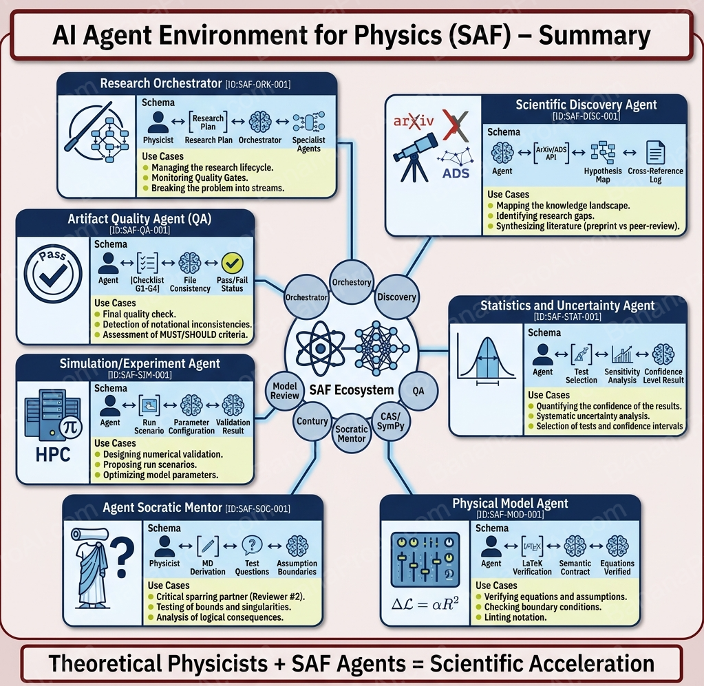

# SAF Physics LTR ⚛️ **Science 2.0 Operating System**

**SAF Physics LTR is an operating system for theoretical research. It does not replace scientists—it replaces the repetitive, error-prone coordination work surrounding scientific research while preserving full human oversight.**

**Multi-agent research platform** for SAF/LTR workflows in theoretical physics.
✅ Human-in-the-loop quality gates | Formal consistency checks | Literature cross-reference
⭐ **Fork, star, contribute!**



## Quickstart
```bash
git clone https://github.com/ThrennPL/saf-physics-ltr
cd saf-physics-ltr
python -m venv .venv
source .venv/bin/activate  # Linux/Mac
# .venv\Scripts\activate  # Windows
pip install -r requirements.txt

# Optional: developer dependencies (lint/test/typecheck/build)
pip install -r requirements-dev.txt

# Optional: enable pre-commit MCP drift gate
pre-commit install

# Optional: ADS token
# Copy .env.example to .env and fill ADS_API_TOKEN

# Security/MCP sanity check
python tools/security_sanity_check.py

# First agent run
python tools/arxiv_search.py "lagrangian stability" --max 5
```

## Minimal Inputs (Required to Start)
- Hypothesis and research goal.
- Scope and exclusions.
- Research variant (theoretical/experimental/computational).
- Critical assumptions.
- Filled `Dokumentacja/Karta-Badania.md`.

## Why SAF?
**Theoretical physics research problems solved:**
- Inconsistent notation → **Agent Formal Consistency**
- Literature gaps → **ArXiv/ADS Discovery Agent**
- Reproducibility issues → **LTR validation and formal checks**
- Gate review delays → **Automated Quality Gates G1-G4**

## Core Architecture
14 Specialized Agents:
- Research Orchestrator: routes workstreams, coordinates gate transitions, aggregates statuses.
- Formal Consistency: validates notation/ID consistency and resolves notation conflicts.
- Model Review: resolves physical and domain-level conflicts.
- Physics Discovery: frames discovery directions and research questions.
- Cross-Reference: executes ArXiv/ADS literature linkage and evidence mapping.
- Data Quality: validates dataset quality before uncertainty analysis.
- Statistics Review: evaluates uncertainty/CI and inference robustness.
- Risk & Compliance: tracks risk posture and fail-closed conditions.
- Simulation/Experiment: prepares executable variants and reproducibility checks.
- Socratic Mentor: challenges assumptions, edge cases, and hidden contradictions.
- Artifact Quality: consolidates outputs into gate-ready evidence packets.
- Knowledge Repo: normalizes terminology and reuse taxonomy.
- Language Polish Quality: mandatory PL editorial validation before finalization/PDF.
- Technical Developer: code patches, automation, and tooling incident handling.

## Architecture 2.1: Layered Runtime (Environment Scope)
The environment now uses a layered runtime split where governance and execution contracts are explicit and validated fail-closed:

- Agents: orchestration, ownership, escalation (`.github/agents/`).
- Skills catalog: runtime mapping of reusable skills (`mcp/skills/skill_catalog.json`).
- Tool contracts: stable interface between skills and tools (`mcp/tools/tool_contract_index.json`).
- Backend layer: backend interface and capabilities (`mcp/backends/`).
- Guardrails validation: contract integrity and agent-skill coverage (`python tools/contract_guard.py`).

This change is environment-focused: it improves maintainability and runtime consistency without changing human gate ownership (HITL remains unchanged).

## Orchestration Flow
Default execution order and hard dependencies:
1. Collect required artifacts and case context packs.
2. Run `Formal Consistency -> Model Review` (hard order).
3. Run `Data Quality -> Statistics Review` (hard order).
4. Run `Discovery -> Cross-Reference` for literature scope and links.
5. Run `Language Polish Quality` before final document/package export.
6. Run `Risk & Compliance` in parallel and escalate critical findings.
7. Run `Artifact Quality` to consolidate statuses and recommendation.
8. Human decision for Gate 1/2/4; Gate 3 can be conditional only under low risk.

Escalation rules:
- Any `Blocker` or unresolved conflict is escalated to Orchestrator and then to human.
- Missing required inputs triggers fail-closed behavior.

## Repository Structure

Dokumentacja/ # Templates and registers
├── Karta-Badania.md
├── Rejestr-Konfiguracji-Projektu.md
├── Rejestr-Konfliktow-i-Eskalacji.md
├── Konsolidacja-Statusow.md
├── Review-Jakosci-Gate3.md
├── Podsumowanie-Gate.md
└── Szablon-LTR/ # Literate Theoretical Research templates
Case-Template/ # New research case pattern
.github/agents/ # Agent role configurations
.github/prompts/ # Helper prompts
tools/ # CLI utilities (lint, ArXiv/ADS, model routing)

## Key Files
- **Core Design**: `Assumptions-SAF-Physics.md`
- **PL Assumptions**: `Zalozenia-Srodowisko-Fizyka.md`
- **Decisions Log**: `DECISIONS.md`
- **Agent Config**: `.github/agents/*`
- **Usage Guide**: `Dokumentacja/Instrukcja-Uzycia.md`
- **System Docs**: `Dokumentacja/Dokumentacja-Systemowa.md`

## Tech Stack

Python 3.11+ (recommended 3.13) | pypdf | sympy | bibtexparser | networkx
pillow | pytesseract | chromadb | crossrefapi | graphviz


## LTR Lint (Mathematical Consistency)
```bash
# Basic validation
python tools/lint_ltr.py

# Fail on warnings (CI/CD)
python tools/lint_ltr.py --fail-on-warning
```

## Local QA Runner for n8n

The allowlisted runner exposes only `lint_ltr`, `taxonomy_guard`, and the repository
pytest suite; it does not accept shell commands, file paths, or script arguments
from HTTP callers. Keep the repository outside the n8n container and configure a
random `QA_RUNNER_TOKEN` of at least 32 characters. Bind to `0.0.0.0` only when
Docker must reach the host service, and restrict inbound access to port 8765 with
the host firewall.

```powershell
$env:QA_RUNNER_TOKEN = "<random token of at least 32 characters>"
python tools/qa_runner_service.py --host 0.0.0.0 --port 8765
```

In n8n, create a Header Auth credential with header name `Authorization` and value
`Bearer <the same token>`. Use `http://host.docker.internal:8765/v1/checks` for
the check list or `POST http://host.docker.internal:8765/v1/checks/lint_ltr`,
`POST http://host.docker.internal:8765/v1/checks/taxonomy_guard`, and
`POST http://host.docker.internal:8765/v1/checks/pytest` to run checks.
The runner uses the current repository root, times out after 120 seconds, and caps
captured output. Keep the service local and stop it after use.

### n8n workflow sync via Public API

Create an API key in n8n (Settings -> n8n API) and store it outside the repository,
e.g. as a user environment variable (`N8N_LOCAL_API_KEY_TMD`) or in `.env`. Never
paste it into chats or commit it.

The manual workflow "Repo QA - raport (reczny)" (`n8n/repo-qa-raport-workflow.json`,
ID `Ku19rXEPiP6PkDWu`) runs the three checks; a status other than `OK` appends an entry
to `qa-alerts.log` in the n8n files mount (`/data` in the container).

It also writes a Polish Markdown report to
`reports/qa-<timestamp>.md` in the n8n files mount (`D:\n8n-files\reports`). It is
not scheduled or published.

The older "Repo QA -
ręczne kontrole" was archived in n8n (restorable) and its export removed from the repo.

Sync with `tools/n8n_sync.py` (reads `N8N_API_KEY` / `N8N_LOCAL_API_KEY_TMD`, refuses
to write or push files that look like they contain secrets):

```powershell
python tools/n8n_sync.py list
python tools/n8n_sync.py pull Ku19rXEPiP6PkDWu n8n/repo-qa-raport-workflow.json
python tools/n8n_sync.py push Ku19rXEPiP6PkDWu n8n/repo-qa-raport-workflow.json
```

The public API does not manage folders: after creating a workflow, move it to the
`TheoreticalMD` folder in the n8n UI (workflow card -> Move). Credentials (Header
Auth with the runner token) are managed in the UI only.

Literature review workflow "Przeglad literatury arXiv (reczny)" (ID `lS7H9QuTFx6hXuJm`,
export `n8n/repo-arxiv-przeglad-workflow.json`): a form takes the task keywords
(one phrase per line, max 5), arXiv categories and max results per phrase, then calls the
runner endpoint `POST /v1/literature/arxiv` (strict validation, no shell) and writes a
Polish report to `D:\n8n-files\reports\arxiv-<timestamp>.md`. Results are preprints
and are not added to any `Cross-Reference-Log-LTR.md` automatically.
After the report, a second form page ("Wybor publikacji") lists all unique results as
checkboxes plus a research topic (folder name under `Badania/`, e.g.
`T04-GR-PPN-Yukawa-Perihelion`); the selection is saved as
`reports/arxiv-wybor-<timestamp>.json` (status `do_weryfikacji`). With a valid topic and
1-20 selected items the workflow calls runner endpoint `POST /v1/literature/log`, which
only appends a "Kandydaci literatury z arXiv" section (preprint, `do_weryfikacji`) to
`Badania/<topic>/Cross-Reference-Log-LTR.md`; it never edits existing text, skips IDs
already present, and does not touch the claim -> source table.
Run the test form once per "Execute workflow" and use a single browser tab.

Rebuilding n8n from scratch: create the Header Auth credential (runner token) in the UI,
then `python tools/n8n_sync.py restore n8n` creates all missing workflows from `n8n/*.json`
(new IDs; reselect the credential in HTTP nodes if needed), and move them to `TheoreticalMD`. The test form
URL uses the webhook ID (`/form-test/<webhookId>`), not the `path` value.

## ArXiv Cross-Reference
```bash
# Semantic literature search
python tools/arxiv_search.py "CPT violation" --max 10 --cat hep-th
```

## ADS Cross-Reference (token required)
```bash
# Requires ADS_API_TOKEN in .env
python tools/ads_search.py "CPT violation" --max 10
```

## Model Routing
```bash
# Route tasks to optimal models
python tools/route_model.py cross-reference
python tools/route_model.py model-review --gate 3
```

## Reporting Standard
- Status: OK / Warning / Blocker
- Confidence: 0-1 numeric
- Questions: Q-XXX with priority (low/medium/high)

## Prompts
- `.github/prompts/kickoff-badania.prompt.md`
- `.github/prompts/konfigurator-projektu-badawczego.prompt.md`
- `.github/prompts/review-jakosci-badania.prompt.md`
- `.github/prompts/eskalacja-konfliktow.prompt.md`
- `.github/prompts/konsolidacja-statusow.prompt.md`
- `.github/prompts/podsumowanie-gate.prompt.md`

## Pilot Case: T03 Newton-Yukawa Orbit Stability
The team prepared a full pilot case under `Badania/T03-Newton-Yukawa-Orbit-Stability`.

Scientific summary:
- Objective: verify whether a weak Yukawa correction changes local stability of circular orbits.
- Main result: local stability condition
	$1+\beta e^{-x}(1+x-x^2)>0$, where $x=r_c/\lambda$.
- Outcome: baseline Newtonian limit recovered for `beta = 0`; sign impact depends on `(1+x-x^2)`.

Technical summary:
- End-to-end artifact chain completed (research card, derivation, validation register, risk pack, gate checklists).
- Formal validation includes manual checks and CAS closure (`SymPy`, K5 `[VERIFY-CAS]` closed).
- Human-in-the-loop gate decisions recorded as approved for Gate 1-4.

Recommended entry points:
- `Badania/T03-Newton-Yukawa-Orbit-Stability/00-MAPA-CZYTANIA-RECENZJA.md`
- `Badania/T03-Newton-Yukawa-Orbit-Stability/Raport-Wynikowy.md`
- `Badania/T03-Newton-Yukawa-Orbit-Stability/Raport-Wyprowadzen-LTR.md`
- `Badania/T03-Newton-Yukawa-Orbit-Stability/Rejestr-Walidacji-Formalnej-LTR.md`
- `Badania/T03-Newton-Yukawa-Orbit-Stability/Akceptacje-Decyzje.md`

## OCR Requirements
**Tesseract required** (`pytesseract` wrapper only):
```bash
# Ubuntu/Debian
sudo apt install tesseract-ocr

# macOS
brew install tesseract
```

## Semantic Index
**Local ChromaDB** (lightweight vector store).

## DOI Metadata
**CrossRef API** integration for citations.

## Dependency Graphs
**Graphviz system package** required:
```bash
sudo apt install graphviz  # Ubuntu
brew install graphviz      # macOS
```

## 🚀 Contribute
1. **⭐ Star** the repo
2. **Fork** → experiment → PR
3. **Issues** for new agent features
4. **Physics cases** welcome (Case B/C pilots)

**Science 2.0 = Theoretical Physicists + SAF Agents = Scientific Acceleration**

## MCP Baseline (repo-wide)

```bash
# Sync local VS Code MCP config from repository baseline
python tools/mcp_baseline.py sync

# Validate hash lock, allowlists, and local drift
python tools/mcp_baseline.py check

# Update baseline hash lock after approved baseline change
python tools/mcp_baseline.py lock
```

CI also enforces MCP drift checks in `.github/workflows/security-mcp-gate.yml`.

## P0 Process Pack
- Operational runbook: `Dokumentacja/Runbook-Gate-Executor.md`.
- Build minimal evidence packet:
	- `python tools/build_evidence_packet.py --owner "HUMAN_OWNER" --decision pending --gate-id G3 --manifest-mode inline --strict-metadata --artifact "Dokumentacja/Konsolidacja-Statusow.md|Warning|Initial consolidation" --artifact "Dokumentacja/Rejestr-Konfliktow-i-Eskalacji.md|Warning|Initial conflict register" --artifact "Dokumentacja/Podsumowanie-Gate.md|Warning|Final decision pending owner review" --require-artifact Dokumentacja/Konsolidacja-Statusow.md --require-artifact Dokumentacja/Rejestr-Konfliktow-i-Eskalacji.md --require-artifact Dokumentacja/Podsumowanie-Gate.md`
	- `--strict-metadata` is fail-closed: missing critical artifacts or `Missing/Blocker` status stops the process.
	- Zero-loss guard: the generator builds index/status metadata and does not move scientific content out of case artifacts.
- Taxonomy drift guard (alias map + canonical terms):
	- `python tools/taxonomy_guard.py`
- Combined task in VS Code:
	- `quality-gates-plus-p0`
	- `stage-f-contract-guard` (Workflow/Capability/Skill/Tool contract validation)
	- `dual-run-stage-f` (legacy P0 path + T04 process-suite)
	- `quality-gates-plus-p0-process-suite` (full chain; includes `stage-f-contract-guard` via `p0-process-check`)
	- `migration-metrics-report` (periodic MM-001..MM-005 migration metrics report)
	- `gate-timing-report` (Gate 1-4 telemetry aggregation from `docs/operations/gate_timing_log.jsonl`)
	- `build-offline` (attempt package build using `python -m build` without isolation)
	- `build-smoke-offline` (fallback build check via `python -m pip install . --no-deps --no-build-isolation`)
	- `quality-gates-offline` (lint+test+typecheck+build-smoke-offline)
	- `owner-weekly-summary` (weekly owner summary from operations cycle logs)

Windows scheduler automation:
	- register tasks: `powershell -ExecutionPolicy Bypass -File tools/scheduler/register_windows_tasks.ps1`
	- runner: `tools/scheduler/run_ops_cycle.ps1`
	- scheduler log: `docs/operations/scheduler_runs.log`
